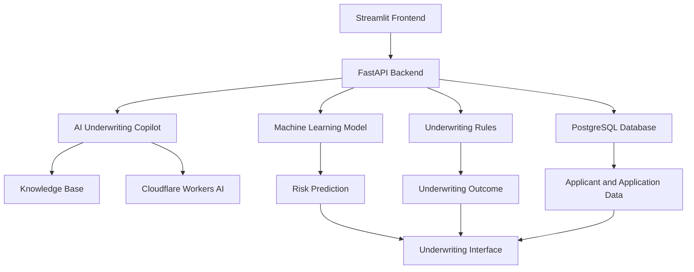

# AI Financial Underwriting Copilot

An AI-assisted financial underwriting prototype combining machine learning, rule-based risk assessment, applicant analytics, and an LLM-powered knowledge assistant to support loan underwriting workflows.

> **Disclaimer:** This is a research and portfolio prototype, not a production-ready lending system. Model predictions, risk bands, and policy thresholds are experimental and must not be used as standalone real-world lending decisions.

---

## 1. Project Overview

Financial institutions evaluate loan applicants using financial information, credit history, repayment behaviour, and internal lending policies.

This project explores how machine learning and AI can support the underwriting process through a unified application.

The platform allows users to:

- Explore historical applicant and credit-risk information.
- Generate machine-learning-based default-risk predictions.
- Apply configurable underwriting rules.
- Register new loan applications.
- Review applicant profiles and risk analytics.
- Ask questions through an AI-powered underwriting copilot.

The system is designed to support human decision-making, not replace it.

## 2. Key Features

### Machine Learning Risk Assessment
- Historical loan-default risk prediction.
- Scikit-learn classification model.
- Configurable preprocessing pipeline.
- Model performance metadata.

### Rule-Based Underwriting
- Configurable underwriting policies.
- Risk-band classification.
- APPROVE, REVIEW, and REJECT outcomes.
- Manual-review safeguards when required information is unavailable.

### Applicant and Portfolio Analytics
- Historical applicant exploration.
- Applicant profile information.
- Risk distribution and underwriting analytics.

### New Application Intake
- Register new loan applications.
- Store application and feature information in PostgreSQL.
- Separate application registration from underwriting assessment.

### AI Underwriting Copilot
- Retrieval-based knowledge assistance.
- TF-IDF and cosine-similarity retrieval.
- Cloudflare Workers AI integration.
- Underwriting knowledge base as retrieved context.
- Guardrails intended to prevent AI responses from replacing formal underwriting decisions.

## 3. Application Screens

The Streamlit frontend contains five main sections:

| Screen | Purpose |
|---|---|
| Overview | Project and portfolio overview |
| New Application | Register new loan applications |
| Applicant Profile | Explore applicant information |
| Underwriting | Review risk predictions and policy outcomes |
| AI Copilot | Ask questions about underwriting concepts and policies |

## 4. System Architecture



### Technology Stack

| Layer | Technologies |
|---|---|
| Programming | Python |
| Data Processing | Pandas, NumPy, PyArrow |
| Machine Learning | Scikit-learn, SciPy |
| Explainability | SHAP (dependency) |
| Backend | FastAPI, Uvicorn |
| Frontend | Streamlit |
| Database | PostgreSQL |
| AI Integration | Cloudflare Workers AI |
| Retrieval | TF-IDF, Cosine Similarity |
| Version Control | Git, GitHub |

## 5. Machine Learning Model

The project uses a `HistGradientBoostingClassifier` trained on historical Home Credit Default Risk data.

### Model Metadata

| Metric | Value |
|---|---:|
| ROC-AUC | 0.7824 |
| PR-AUC | 0.2785 |
| Brier Score | 0.0661 |
| Training Records | 246,008 |
| Validation Records | 61,503 |
| Original Predictors | 244 |
| Processed Features | 374 |
| Random State | 42 |

These are recorded project validation metrics, not evidence of production performance or independent external validation.

### Risk Bands

The prototype uses the following configurable risk bands:

| Risk Band | Predicted Default Probability |
|---|---:|
| Low | Below 5% |
| Medium | 5% to below 10% |
| High | 10% to below 20% |
| Very High | 20% or above |

### Underwriting Policy

The prototype uses configurable policy thresholds and rules to generate outcomes:

- **APPROVE:** No configured warning or critical rule is triggered.
- **REVIEW:** A warning condition or default probability of 10% or above triggers review.
- **REJECT:** A critical condition or default probability of 20% or above triggers rejection.

These thresholds are experimental project assumptions, not regulatory or industry standards.

## 6. API Endpoints

The FastAPI backend currently exposes the following endpoints:

| Method | Endpoint | Description |
|---|---|---|
| GET | `/health` | Health check |
| GET | `/model-info` | Retrieve model metadata |
| GET | `/applicants/{applicant_id}` | Retrieve applicant information |
| POST | `/applicants/{applicant_id}/underwrite` | Run an underwriting assessment |
| POST | `/applications` | Register a new application |
| POST | `/copilot/ask` | Ask the AI underwriting copilot |

Interactive API documentation is available at `/docs` when the backend is running.

## 7. Repository Structure

```text
AI-Financial-Underwriting-Copilot/
│
├── api/
│   ├── __init__.py
│   ├── main.py
│   ├── copilot.py
│   ├── new_applications.py
│   └── risk_analytics.py
│
├── Frontend/
│   └── app.py
│
├── database/
│   └── schema.sql
│
├── knowledge_base/
│   └── rag_knowledge_base.json
│
├── models/
│   ├── feature_config.json
│   ├── feature_metadata.json
│   ├── model_metadata.json
│   ├── policy_config.json
│   └── risk_band_config.json
│
├── .env.example
├── .gitignore
├── load_local_data.py
├── requirements.txt
├── test_local_prediction.py
└── README.md
```

Large or sensitive local files, including model binaries, applicant datasets, and environment credentials, are intentionally excluded from the repository.

## 8. Local Setup

### Prerequisites

- Python 3.12
- PostgreSQL
- Git
- Cloudflare Workers AI credentials for the AI Copilot

### Step 1: Clone the Repository

```bash
git clone https://github.com/KunalMaheshwarigithub/AI-Financial-Underwriting-Copilot.git

cd AI-Financial-Underwriting-Copilot
```

### Step 2: Create a Virtual Environment

```bash
python -m venv .venv
```

Activate it in Git Bash:

```bash
source .venv/Scripts/activate
```

### Step 3: Install Dependencies

```bash
pip install -r requirements.txt
```

### Step 4: Configure Environment Variables

Create a local environment file:

```bash
cp .env.example .env
```

Update `.env` with your local PostgreSQL password and Cloudflare credentials.

Never commit `.env` or expose API tokens.

### Step 5: Configure PostgreSQL

Create a PostgreSQL database named:

```text
underwriting_copilot
```

Apply the database schema:

```bash
psql -U postgres -d underwriting_copilot -f database/schema.sql
```

### Step 6: Prepare Required Project Artifacts

The application requires local files that are intentionally not distributed through this repository:

- `models/underwriting_model.joblib`
- `models/preprocessor.joblib`
- `models/applicant_feature_store.parquet`

Obtain or recreate these artifacts using the model-training and data-preparation workflow before starting the application.

The historical feature store contains 307,511 applicant records, with 244 model predictors, `SK_ID_CURR`, and the historical `TARGET` outcome label.

**Important:** `TARGET` is a historical outcome label and must never be used as a predictor for a new application.

The training notebook and large local artifacts are not included in this repository. A fresh clone therefore requires these files to be prepared separately.

### Step 7: Load Historical Applicant Data

After preparing the feature store and creating the database, review the database connection settings in `load_local_data.py` to ensure they match your local PostgreSQL configuration.

Then run:

```bash
python load_local_data.py
```

Run this only after confirming the database and feature-store prerequisites are ready.

### Step 8: Start the FastAPI Backend

```bash
python -m uvicorn api.main:app --host 127.0.0.1 --port 8000 --reload
```

Backend:

`http://127.0.0.1:8000`

Interactive API documentation:

`http://127.0.0.1:8000/docs`

### Step 9: Start the Streamlit Frontend

Open a second terminal, activate the virtual environment, and run:

```bash
python -m streamlit run Frontend/app.py
```

Frontend:

`http://localhost:8501`

## 9. Data and Model Limitations

- The model is trained using historical Home Credit Default Risk data.
- The dataset contains an imbalanced target distribution.
- Historical credit and repayment features may not be available for newly registered applicants.
- Predictions for new applications with incomplete historical information should not be treated as equivalent to validated historical predictions.
- The application includes manual-review safeguards for certain missing-data scenarios.
- Risk bands and policy thresholds are configurable prototype assumptions.
- Model performance requires further validation, calibration, and monitoring before any real-world application.

## 10. Responsible Use and Security

This project is intended for learning, experimentation, and portfolio demonstration.

Before any real-world lending use, the system would require:

- Independent model validation.
- Fairness and bias assessment.
- Legal and regulatory review.
- Data privacy and governance controls.
- Security and access-control testing.
- Auditability and ongoing monitoring.
- Human oversight and documented review procedures.

Do not publish applicant-level data, database exports, credentials, or private model artifacts without appropriate authorization and security review.

## 11. Dataset Acknowledgement

The historical loan-default dataset used for model development is from the **Home Credit Default Risk** Kaggle competition.

Dataset: https://www.kaggle.com/competitions/home-credit-default-risk

---

**AI Financial Underwriting Copilot**

A Data Science and AI portfolio project exploring machine learning, financial risk assessment, backend APIs, database engineering, and LLM-powered knowledge assistance.
