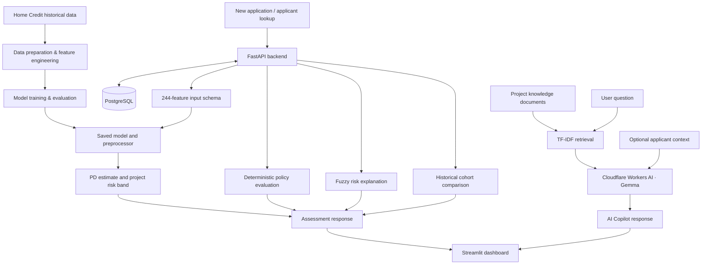

# AI Financial Underwriting Copilot

> An explainable, ML-assisted financial underwriting prototype that combines credit-default risk prediction, deterministic policy checks, fuzzy risk explanations, historical-applicant comparison, and a retrieval-augmented AI Copilot.

**Status:** Active prototype development · **Interface:** Streamlit · **API:** FastAPI · **Database:** PostgreSQL

---

## Overview

The AI Financial Underwriting Copilot is an end-to-end decision-support project built around the Home Credit Default Risk problem. It is designed to demonstrate how a data science model can be integrated into a usable application with data storage, API services, policy logic, explainability, and a natural-language interface.

The application is intended to help a reviewer explore an applicant profile, inspect a model-generated probability of default (PD), examine policy-rule outcomes, understand fuzzy risk indicators, compare an applicant with a labelled historical reference cohort where available, and ask questions through an AI Copilot.

This is a **portfolio/research prototype**, not a production lending system. It does not make legally binding credit decisions and must not be used to approve, reject, price, or otherwise determine real credit applications.

## What the system demonstrates

| Capability | Purpose |
|---|---|
| Applicant intake | Validate and persist new application details |
| Feature engineering | Construct the model-compatible feature payload from supplied inputs |
| ML inference | Estimate probability of default with a saved scikit-learn pipeline |
| Risk bands | Map a probability estimate to the project's configured risk categories |
| Policy engine | Evaluate deterministic rules and distinguish failed checks from unavailable checks |
| Fuzzy risk explanation | Show gradual membership across supported risk indicators |
| Historical comparison | Compare against a labelled local reference cohort when suitable data are available |
| RAG knowledge retrieval | Retrieve project and policy documentation using TF-IDF similarity |
| AI Copilot | Use retrieved context and optional applicant context to answer natural-language questions |
| Audit trail | Persist application creation and underwriting events in PostgreSQL |

## Architecture



The diagram describes the intended prototype flow. Exact feature availability, cohort evidence, and model reliability depend on the data supplied for an individual assessment.

## Technology stack

| Area | Technologies |
|---|---|
| Programming | Python |
| Data processing | pandas, NumPy |
| Machine learning | scikit-learn, HistGradientBoostingClassifier, joblib |
| Backend | FastAPI, Uvicorn, Pydantic |
| Database | PostgreSQL, SQL, psycopg2 |
| Frontend | Streamlit |
| Retrieval | TF-IDF vectorization, cosine similarity |
| Generative AI | Cloudflare Workers AI, Gemma model |
| Data interchange | JSON, Parquet |
| Version control | Git, GitHub |

Docker, automated CI/CD, cloud deployment, and production MLOps are planned extensions; they should not be considered implemented until their workflows are added and verified.

## Dataset and model

The model development is based on the [Home Credit Default Risk dataset](https://www.kaggle.com/competitions/home-credit-default-risk), with the main training cohort represented by `application_train`.

Recorded project cohort statistics:

- Applications: **307,511**
- `TARGET = 1` (historical payment difficulty): **24,825** (~8.07%)
- `TARGET = 0`: **282,686** (~91.93%)

The saved model is a `HistGradientBoostingClassifier` and expects **244 predictors**. `TARGET` and the applicant identifier are not model predictors.

### Recorded evaluation metrics

| Metric | Recorded value |
|---|---:|
| ROC-AUC | 0.782369 |
| PR-AUC | 0.278541 |
| Brier score | 0.066097 |

These are the metrics recorded during the project's historical-data evaluation. They are not a guarantee of performance on new applications, on a different population, or on profiles with substantial feature imputation. The full evaluation protocol, split strategy, calibration analysis, and reproducibility evidence should be documented alongside the model-development notebooks.

## Important distinction: historical applicants vs new applications

The historical training records include predictors that may describe previous credit activity, bureau information, and repayment behaviour. The current new-application intake form collects only a subset of the 244 model features.

For a new applicant, unavailable historical fields remain missing and are handled by the saved preprocessing pipeline where supported. This allows technical inference, but **a returned probability is not automatically a reliable estimate for a profile that differs materially from the model's training population**.

The application therefore separates:

1. The ML model output.
2. Deterministic policy checks, including `NOT_EVALUATED` for unavailable evidence.
3. Fuzzy indicators derived from available inputs.
4. Historical cohort comparisons, when sufficient labelled reference data are available.
5. Data-quality and evidence limitations.

Fuzzy indicators and similarity-based cohort statistics are explanatory/experimental components. They are not calibrated probabilities of default and must not be blended into a purported final credit score without a documented methodology and out-of-sample validation.

## Project decision rules

The current prototype uses configurable project thresholds for risk bands and policy outcomes. These are engineering assumptions used to demonstrate a workflow; they are **not official lender rules, regulatory thresholds, or validated lending criteria**.

Unavailable historical information must not be interpreted as a policy failure. Likewise, a low model score must not be presented as a validated approval recommendation when required evidence is absent.

## Application workflow

1. Register a new application or select a historical applicant.
2. Retrieve the saved applicant feature profile.
3. Run model inference and inspect the predicted PD and configured risk band.
4. Review each deterministic policy outcome: `PASSED`, `WARNING`, `CRITICAL`, or `NOT_EVALUATED`.
5. Inspect fuzzy risk memberships and their supporting inputs.
6. Review historical-cohort evidence and its sample-size/quality caveats.
7. Ask the AI Copilot questions about the model, policy documentation, or recorded applicant assessment.

## API overview

The FastAPI service currently exposes the following core workflow endpoints:

| Method | Endpoint | Purpose |
|---|---|---|
| GET | `/health` | API and database health |
| POST | `/applications` | Create and persist a new application |
| GET | `/applicants/{applicant_id}` | Retrieve an applicant profile |
| POST | `/applicants/{applicant_id}/underwrite` | Run inference, policy evaluation, and persist assessment outputs |
| POST | `/copilot/ask` | Ask the RAG-based AI Copilot |

Interactive API documentation is available at `/docs` when the local FastAPI service is running.

## Local development

The project is developed locally with Python 3.12, PostgreSQL, FastAPI, and Streamlit.

The intended local startup commands, executed from the project root, are:

```powershell
# Terminal 1 — API
.\.venv\Scripts\python.exe -m uvicorn api.main:app --host 127.0.0.1 --port 8000 --reload

# Terminal 2 — dashboard
.\.venv\Scripts\python.exe -m streamlit run frontend/app.py
```

The application also requires:
- A running PostgreSQL instance and the project database schema.
- The model artifacts and feature/policy configuration files.
- A project-root `.env` file containing local database credentials and Cloudflare Workers AI credentials for Copilot functionality.

**The reproducible installation guide and dependency lock/requirements file are being prepared.** Do not assume a clean installation is possible from this README alone until those files and setup steps are committed.

## Repository layout

The planned repository structure is:

```text
api/                 FastAPI routes and backend services
frontend/            Streamlit dashboard
database/            PostgreSQL schema and database documentation
knowledge_base/      RAG source documents
models/              Model metadata and non-sensitive configuration
notebooks/            Data exploration, preprocessing, training, evaluation
docs/                 Architecture, methodology, and model documentation
screenshots/          Sanitized application screenshots
tests/                Unit and integration tests
.github/workflows/    CI workflows
```

Only files that have been reviewed for secrets, data rights, privacy, and reproducibility should be committed. Local model binaries, raw datasets, applicant-level feature stores, credentials, and database exports should remain outside the public repository unless their redistribution is explicitly permitted and there is a clear need to publish them.

## Security and responsible use

- Never commit `.env`, API tokens, database passwords, private keys, or Streamlit secrets.
- Do not publish applicant-level records, raw datasets, database dumps, or the local applicant feature-store Parquet file.
- Use synthetic or properly anonymized examples in screenshots and demonstrations.
- Review dataset and model redistribution terms before publishing artifacts.
- Assess feature coverage, missingness, data drift, calibration, subgroup performance, fairness, and out-of-distribution behaviour before any real-world use.
- Keep human review and institutional governance outside the scope of automated prototype outputs.

## Current limitations

- New-applicant intake collects fewer than the 244 features expected by the historical model.
- Predictions for new applicants with missing historical features have not been validated for that input profile.
- Policy checks that need unavailable historical data remain `NOT_EVALUATED`.
- Fuzzy memberships and historical similarity comparisons are exploratory explanations, not independently validated credit-risk models.
- The RAG retriever currently uses lexical TF-IDF similarity; this is not a production hybrid/vector-search architecture.
- The application is a local prototype; production authentication, tenant isolation, deployment hardening, monitoring, and governance are not yet established.

## Roadmap

- [ ] Finalize and document the model evaluation protocol and calibration.
- [ ] Validate fuzzy memberships and decision-support rules on held-out data.
- [ ] Validate historical-cohort matching, sample-size thresholds, and uncertainty reporting.
- [ ] Improve feature coverage for new applications through authorized data sources.
- [ ] Add automated unit, API, and integration tests.
- [ ] Add GitHub Actions CI.
- [ ] Add Docker and reproducible local environment configuration.
- [ ] Add structured observability, audit review, and cost/latency tracking for LLM calls.
- [ ] Evaluate stronger hybrid retrieval and reranking for RAG.
- [ ] Prepare a sanitized end-to-end demo and screenshots.

## Acknowledgements

- Dataset: [Home Credit Default Risk — Kaggle](https://www.kaggle.com/competitions/home-credit-default-risk)
- Generative AI inference: [Cloudflare Workers AI](https://developers.cloudflare.com/workers-ai/)

---

**Disclaimer:** This project is an educational and portfolio-oriented prototype. It is not financial advice, a credit bureau, a regulated lending product, or an automated decision system suitable for real applicants.
